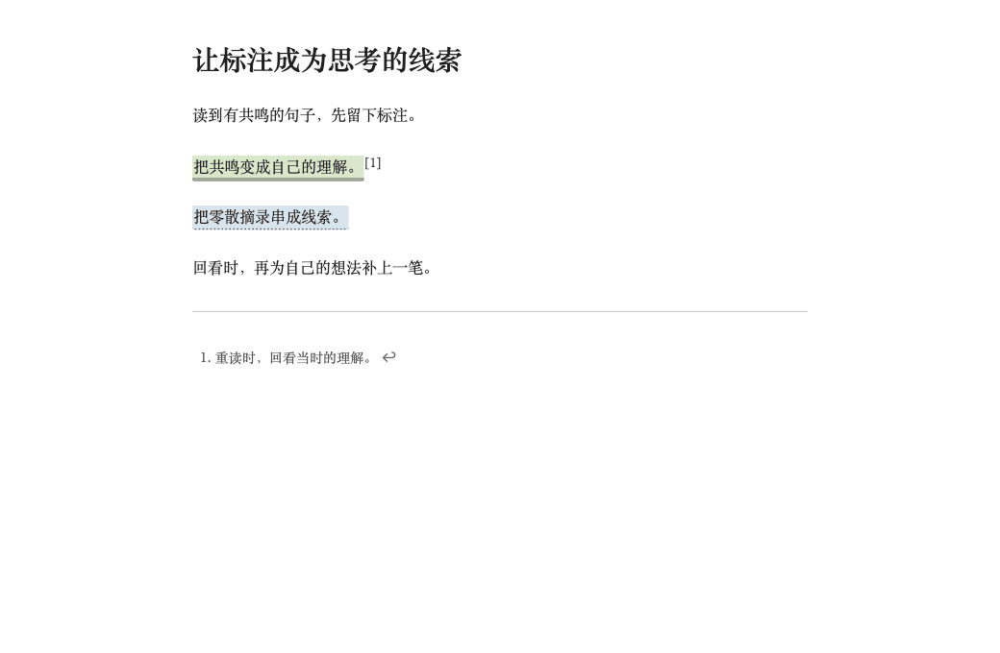

# Inkstone Annotations · 墨读标注

[简体中文](README.zh-CN.md) · English

Standalone plugin files: [latest release](https://github.com/bufan1024/obsidian-inkstone-annotations/releases/latest) · [main.js](https://github.com/bufan1024/obsidian-inkstone-annotations/releases/latest/download/main.js) · [manifest.json](https://github.com/bufan1024/obsidian-inkstone-annotations/releases/latest/download/manifest.json) · [styles.css](https://github.com/bufan1024/obsidian-inkstone-annotations/releases/latest/download/styles.css). The plugin is not yet confirmed as listed in Obsidian's community directory.

## Demos




Underlines, four highlight colors, footnote thoughts, a current-note sidebar, and Markdown excerpt export for Obsidian. **Plugin 1.1.7**, paired with **Inkstone theme 1.3.7**; requires Obsidian **1.10.6 or later**.

The interface is currently in Chinese. This guide preserves the actual labels and gives their English meanings. Install from [GitHub Releases](https://github.com/bufan1024/obsidian-inkstone-annotations/releases/latest) or this repository; this plugin is not yet listed in Obsidian's community directory.

Everything is processed locally through Obsidian APIs. No network calls, account, or other plugin is required. Live Preview uses CodeMirror bundled with Obsidian. Annotations are saved directly in Markdown and remain compatible with older Inkstone markup. The Inkstone theme is plain CSS and can be used separately.


## Install and update

Quit Obsidian. Place these three runtime files in your vault:

```text
Your vault/
└── .obsidian/
    └── plugins/
        └── inkstone-annotations/
            ├── main.js
            ├── styles.css
            └── manifest.json
```

Use your actual configuration folder if it differs from `.obsidian`. Avoid an extra nested `inkstone-annotations` directory. Reopen Obsidian, open **Settings → Community plugins**, turn off Restricted mode, and manually enable **「Inkstone Annotations」**. Restart if it does not appear. A standalone theme package does not include JavaScript or add annotation controls.

For a manual update, quit Obsidian, back up the old files, and replace only the three runtime files above. Keep `data.json`.

The optional installer belongs to the [upstream theme repository](https://github.com/bufan1024/obsidian-inkstone) or its reading kit, and is not included here. Run the following only from the upstream checkout or extracted kit:

```sh
python3 scripts/install.py --vault "/absolute/path/to/your/vault" --update --plugin-only --dry-run
python3 scripts/install.py --vault "/absolute/path/to/your/vault" --update --plugin-only
```

Use `py -3` instead of `python3` on Windows. Add `--config-dir "folder-name"` to both commands for a custom configuration folder. For a first plugin-only installation, use `--plugin-only` without `--update`. Plugin-only installation preserves your theme, color scheme, and readable-line-width preferences. The installer backs up changed files and preserves notes, plugin data, and other plugin settings; it does not enable the plugin.

See the [English project guide](https://github.com/bufan1024/obsidian-inkstone/blob/main/README.en.md#install-or-update) for the full reading kit, theme-only options, manual theme installation, and an [English AI installation prompt](https://github.com/bufan1024/obsidian-inkstone/blob/main/README.en.md#install-with-codex-or-another-ai-assistant).

## Add a highlight or thought

1. Select plain text within one source line. Visual line wrapping is fine; do not cross an explicit newline.
2. For a quick mark, click **「划线」 (Mark)** to reuse the latest style and color. Its adjacent **「划线样式」 (Annotation style)** arrow offers an underline or yellow, green, blue, and pink highlights. Choosing one saves immediately.
3. For a note, click **「写想法」 (Write a thought)**. A small popover beside the text shows the source quote, a multiline input, and style choices. A new plain-text selection defaults to an underline; an existing annotation starts with its current style.
4. Click **「保存想法」 (Save thought)**, or press `Cmd+Enter` on macOS / `Ctrl+Enter` on Windows or Linux. The style and thought are saved together. Changing styles keeps the input and does not write to the note before Save. **「取消」 (Cancel)** writes neither the draft style nor the thought.

Thoughts are native footnotes appended to the current note. Click a footnote number to jump to the thought, and its return link to go back to the text.

The commands **「墨读：标注与备注」 (Annotation and note)** and **「墨读：添加备注」 (Add note)**, the context-menu entry **「墨读：标注与备注…」**, and the ribbon highlighter icon still open the full annotation panel. Use **「保存标注」 (Save annotation)** or `Cmd+Enter` / `Ctrl+Enter` there; canceling writes nothing.

Reading view supports simple paragraphs occupying one source line, including further annotations beside existing Inkstone marks and footnotes. For paragraphs with links, bold text, or other complex Markdown, switch to the editor and select a plain-text portion.

See the [recorded annotation demo](https://github.com/bufan1024/obsidian-inkstone/blob/main/README.en.md#select-text-and-write-a-thought).

## Edit or remove an existing annotation

Click a rendered highlight or underline in reading view or Live Preview to open a small menu beside it. When the mark has keyboard focus, `Enter` or Space also opens the menu. The sidebar's **「编辑」 (Edit)** button opens the same menu beside that button.

- Select a color or **「下划线」 (Underline)** on the first screen to apply it immediately to the whole annotation. The current style is indicated.
- Choose **「写想法」 (Write a thought)**, or **「编辑想法」 (Edit thought)** when a note exists. The composer stays inside the same popover. Style choices change only the draft until **「保存想法」** or `Cmd+Enter` / `Ctrl+Enter` saves the style and thought together. Keeping the style unchanged preserves the existing mark. Cancel returns to the menu without writing the draft.
- Choose **「删除标注」 (Delete annotation)** to remove the mark while keeping the text.

Click outside, press `Esc`, scroll, or switch notes to close the menu. The reading-view context menu and the full annotation commands continue to provide the larger panel.

In the editor, placing the cursor inside an annotation's text, or selecting part of that text, then running an annotation command updates the whole mark rather than nesting another mark. Keep the HTML tags themselves out of the selection.

Removing a mark cleans up only Inkstone footnotes that are no longer referenced. Shared definitions needed by other marks remain. Editing the thought for one of several marks sharing a note creates a separate footnote for that mark.

## Live Preview and source mode

Live Preview renders the highlight or underline when the cursor and selection are outside it. Moving into the annotation reveals the original HTML for editing. Source mode always shows the saved markup. These display changes do not rewrite the file or require migration of older notes.

## Sidebar and excerpt export

Run **「墨读：打开标注侧栏」 (Open annotation sidebar)**, or choose **「更多 → 打开标注侧栏」 (More → Open annotation sidebar)** from the selection toolbar. It lists annotations from the current Markdown note and refreshes when that note changes.

The header shows the note name, folder, and annotation count; hover over the path to see the full location. Quotes and thoughts have separate visual levels. The list scrolls independently while the filter and export controls remain visible. Action buttons stay visible:

- **「定位原文」 (Locate source)** jumps to the mark.
- **「编辑」 (Edit)** opens the [small annotation menu](#edit-or-remove-an-existing-annotation) beside the button. First-screen style choices apply immediately; thought drafts are saved within the popover, and Cancel writes nothing.
- **「删除」 (Delete)** removes the annotation and keeps the source text.

Filter by a color or underline, or choose **「全部标注」 (All annotations)**. Switching notes updates the list; it is a current-note view, not a vault-wide annotation search.

Click **「导出摘录」 (Export excerpts)**, choose **「更多 → 导出当前笔记摘录」**, or run **「墨读：导出当前笔记摘录」**. Export always includes **all annotations in the current note**, regardless of the sidebar filter, with their thoughts and a source link.

The new file is created beside the original as `Original note-墨读摘录.md`, then `Original note-墨读摘录-2.md`, and so on if necessary. It opens automatically without overwriting the source or previous exports. An export is a snapshot, not a synchronized view. The sidebar follows the newly opened file; switch back to the original note to continue managing its annotations.

See the [recorded sidebar and export demo](https://github.com/bufan1024/obsidian-inkstone/blob/main/README.en.md#edit-from-the-sidebar-and-export-excerpts).

## Toolbar, reading settings, and paging

The selection toolbar offers **「复制」 (Copy)**, **「划线」 (Mark)**, **「写想法」 (Write a thought)**, and **「更多」 (More)**. The style arrow shows labeled color dots and an underline option; these choices save immediately. The main Mark button reuses your latest style, while an existing mark keeps its current style. More also provides removal for an existing annotation.

The toolbar keeps the captured selection, uses its own interface text size, and appears above the selection or below it when space is limited. Press `Esc` or scroll to dismiss it. Turning off **「快捷标注条」 (Quick annotation toolbar)** in plugin settings still leaves context-menu and command-palette access.

Use Obsidian **Settings → Appearance** for font and font size. The theme supports an optional CSS variable, `--inkstone-font-size`; remove an existing override to restore native font-size control.

| Reading setting | Choices |
| --- | --- |
| Line height | 「跟随主题 / CSS」 (Follow theme / CSS), 1.5, 1.75, 2.0 |
| Line width | Follow theme / CSS, 32em, 40em, 48em |
| Reset presets | Restore theme/CSS line height and width, keeping native font settings |

These presets are designed for Inkstone. Enable **Settings → Editor → Readable line length** when using width presets. If you set width or line height in a CSS snippet, choose Follow theme / CSS in the plugin.

Run **「墨读：上一屏／下一屏」 (Previous / Next screen)** or use status-bar ↑ / ↓ to scroll by the current content viewport with a small overlap. Reading and editing views are supported; no page-break characters are inserted. Assign shortcuts under Settings → Hotkeys if desired.

## Commands and undo

The plugin provides 13 commands. Search for **墨读** in the command palette (`Cmd+P` / `Ctrl+P`) to find them. There are no default dedicated hotkeys.

| Actual command label | Action |
| --- | --- |
| 墨读：标注与备注 | Open the full annotation panel; remember the last style and color |
| 墨读：添加下划线 | Add an underline or change an existing mark to an underline |
| 墨读：黄色高亮 | Add or change to a yellow highlight |
| 墨读：绿色高亮 | Add or change to a green highlight |
| 墨读：蓝色高亮 | Add or change to a blue highlight |
| 墨读：粉色高亮 | Add or change to a pink highlight |
| 墨读：添加备注 | Open the full note panel; new plain-text selections default to an underline |
| 墨读：切换彩色／灰阶标注 | Switch display mode without changing saved colors |
| 墨读：撤销上次标注 | Undo the most recent annotation addition, edit, or removal |
| 墨读：打开标注侧栏 | Show the current note's annotations |
| 墨读：导出当前笔记摘录 | Create Markdown with all annotations, thoughts, and a source link |
| 墨读：上一屏 | Scroll to the previous screen with some overlap |
| 墨读：下一屏 | Scroll to the next screen with some overlap |

In the editor, use native undo and redo (`Cmd+Z` / `Ctrl+Z` and the corresponding system redo shortcut). Each annotation operation groups source and footnote changes into one editor transaction.

In reading view, **「墨读：撤销上次标注」** remembers only the most recent annotation action since the plugin was loaded. It requires the same note with no subsequent changes. After other edits, use editor undo. It does not provide multi-step annotation history or delete exported files.

## Color and e-ink display

Highlights use pale backgrounds with dark text. Enable **「墨水屏显示」 (E-ink display)** in the full panel or plugin settings to use a light gray background with distinct line patterns:

| Saved color | Grayscale line pattern |
| --- | --- |
| Yellow | Solid |
| Green | Double |
| Blue | Dotted |
| Pink | Dashed |

Changing the display leaves saved colors intact and can be reversed. With the plugin disabled, the Inkstone theme still displays the saved HTML marks and native footnotes.

## Saved format and selection limits

Underlines and highlights use HTML, and thoughts use native Obsidian footnotes:

```markdown
<u class="inkstone-underline">A sentence to revisit</u>[^inkstone-demo-1]

<mark class="inkstone-highlight inkstone-yellow">A useful idea</mark>

[^inkstone-demo-1]: My thought about this sentence.
```

The color classes are `inkstone-yellow`, `inkstone-green`, `inkstone-blue`, and `inkstone-rose`. You can edit markup and footnotes directly in source mode. Older Inkstone formats remain supported.

Select plain text within a single source line, leaving heading, list, and quote prefixes outside the selection. HTML tags and attributes, link destinations, code, math, and frontmatter are protected. Cross-line selections and selections spanning complete Markdown or HTML structures are rejected. If prompted, switch to the editor and select a smaller plain-text portion.

Reading view uses Obsidian's source-paragraph information and character mapping to distinguish repeated text. Complex Markdown, unknown HTML, and paragraphs spanning source lines require editor selection. If you switch files, disable the plugin, or change the source while a menu or panel is open, saving is rejected; reopen it from the current text.

Copy the [annotation example](examples/划线与备注示例.md) into your vault to practice. The [validation record](https://github.com/bufan1024/obsidian-inkstone/blob/main/VALIDATION.md) documents local macOS Obsidian 1.12.4 / 1.14.4 verification. Narrow-window and synthetic touch tests do not constitute testing on native mobile apps or physical e-ink devices; neither has been tested.

## Development and license

Use Node.js 22 or later. No package installation or third-party build dependencies are required:

```sh
node build.mjs
node --test tests/*.test.cjs
```

`npm run build` and `npm test` run the same commands. The build reads only this repository's `src/` and `manifest.json`, and generates `main.js` and `styles.css`.

Plugin source is maintained once, in the [upstream annotations directory](https://github.com/bufan1024/obsidian-inkstone/tree/main/annotations). Submit source changes there, then regenerate this distribution with the upstream `scripts/export_plugin.py`; do not maintain a divergent copy here. The local example is an exported copy of the upstream example.

[MIT License](LICENSE). For bug reports, include your Obsidian version, operating system, view mode, a minimal note, and relevant CSS snippets.
